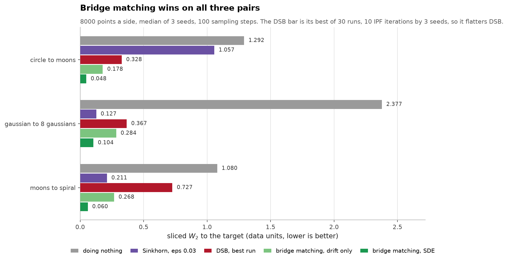
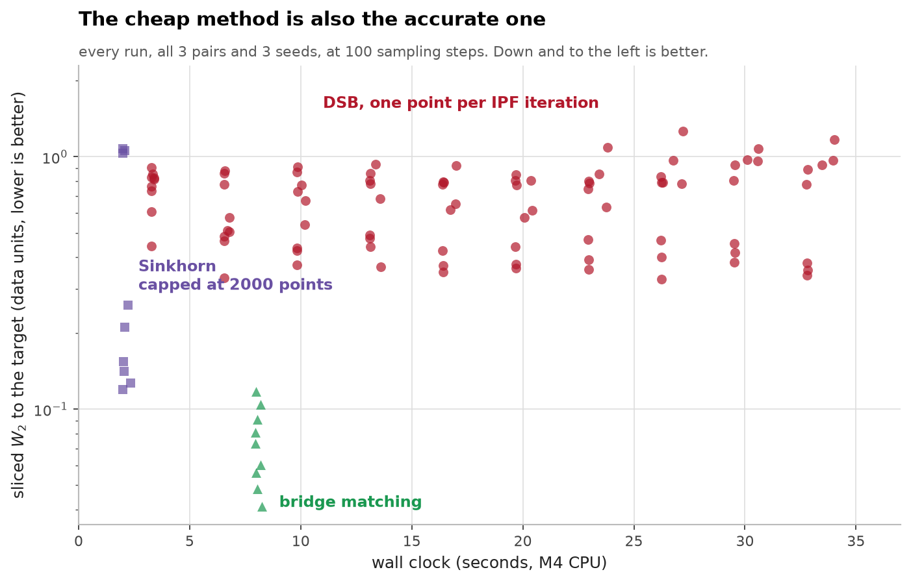
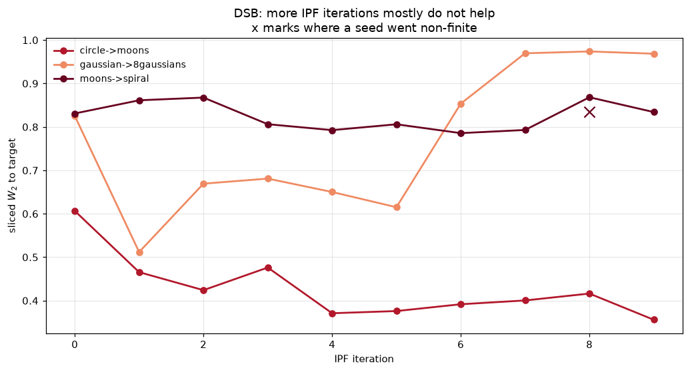
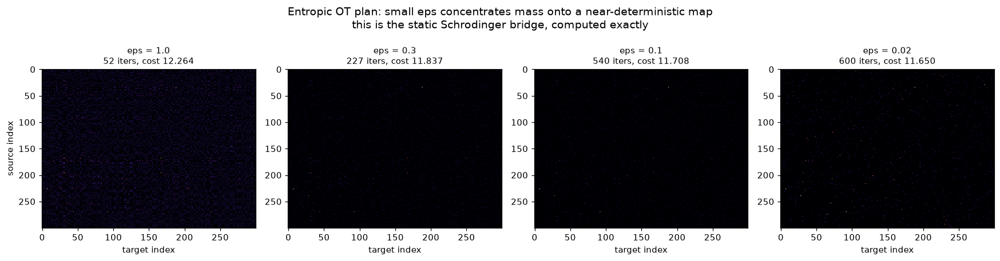
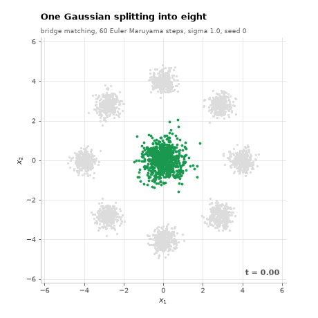
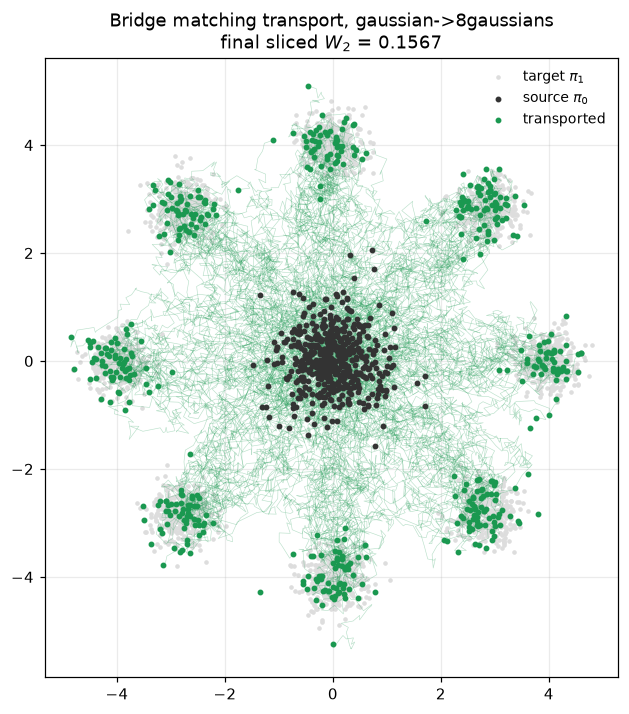

# schrodinger-bridge-from-scratch

[](https://github.com/aghasalim/schrodinger-bridge-from-scratch/actions/workflows/ci.yml)
[](https://www.python.org/)
[](LICENSE)
[](results/)
[](https://doi.org/10.5281/zenodo.23003678)

I implemented entropic optimal transport, diffusion Schrodinger bridges with
iterative proportional fitting, and bridge matching from the papers. Then I
compared them at matched compute on my laptop CPU. I recompute every published
number from `results/` with code in `verify/` that shares nothing with the code
that produced it, and CI fails the build if any of them disagree.

I mainly wanted to know if full DSB is worth its cost compared to the simulation
free method that replaced it. On these toy problems it isn't, and the gap was
big enough that I thought it was worth writing up.

## What the problem is

A diffusion model moves a Gaussian to your data. The Schrodinger bridge problem
is the more general version. You have two arbitrary distributions and a reference
process, and you look for the process that is closest in KL to the reference
while moving one distribution exactly onto the other. It's the dynamic form of
entropic optimal transport. Standard diffusion is the special case where one end
happens to be Gaussian.

I implemented three ways to solve it.

Sinkhorn solves the static problem directly. You give it a cost matrix and a
regularisation eps, and it finds the coupling that minimises transport cost minus
eps times entropy. It's exact, so I use it as the ground truth to check the others.
It doesn't scale past a few thousand points, though, because it needs the full
cost matrix.

DSB solves the dynamic problem with iterative proportional fitting. It uses two
networks and alternates between them. First it fits a backward drift on
trajectories from the forward process, then a forward drift on trajectories from
the backward one, and repeats. Each outer iteration needs a full simulation pass
and a full training pass.

Bridge matching takes flow matching and swaps the straight interpolant for a
Brownian bridge, which is the reference process conditioned to hit both
endpoints. It needs one network and one regression. There are no alternating
iterations and no simulation during training.

## Results

Sliced Wasserstein-2 to the target, median of 3 seeds, 8000 points per side:

| pair | doing nothing | Sinkhorn (eps 0.03) | DSB (best run) | bridge match (drift only) | bridge match (SDE) |
|---|---:|---:|---:|---:|---:|
| circle to moons | 1.292 | 1.057 | 0.328 | 0.178 | **0.048** |
| gaussian to 8 gaussians | 2.377 | 0.127 | 0.367 | 0.284 | **0.104** |
| moons to spiral | 1.080 | 0.211 | 0.727 | 0.268 | **0.060** |

Every column is the median of 3 seeds except DSB. For DSB I took the best of its 30
runs, 10 IPF iterations by 3 seeds. That's as generous to DSB as I could be, and it
still loses.

The drift only column isn't an ODE sampler. It runs the drift trained with
sigma = 1 and just drops the noise term. A proper probability flow ODE would also
need a score correction that I never learned. So that column is a biased
deterministic sampler, and the SDE column is the one that actually samples the
bridge.



Wall clock on the same CPU, per pair:

| method | time | networks | notes |
|---|---:|---:|---|
| Sinkhorn | 2.0 s | 0 | but capped at 2000 points by the cost matrix |
| bridge matching | 8.0 s | 1 | one regression, no simulation while training |
| DSB | 33 s | 2 | 10 IPF iterations, each simulating and training |

Bridge matching costs four times less than DSB and gets closer to the target on
every pair. How much closer depends on the column. Compared with DSB's best run,
the drift only column is 1.84x, 1.29x and 2.71x lower in sliced W2, in table row order.
The SDE column is 6.77x, 3.52x and 12.08x lower.



Be careful reading that figure. I timed each DSB run once as a whole, then split
that total evenly over its 10 IPF iterations to place the ten red points. So the
height of a DSB point is measured, but its x position comes from that even split.
That's also why the points line up in stripes. The 33 s total is what I actually
measured. The experiment now times each IPF iteration separately, so future runs
won't need the split.

## DSB does not improve with more iterations
Mine doesn't, and I think it's the most interesting negative result here.



Derivation in [notes/METHODS.md](notes/METHODS.md#dsb-does-not-improve-with-more-iterations).

## The static bridge
I think the Sinkhorn plan is worth looking at by itself, since it's what all the other methods are approximating.



Derivation in [notes/METHODS.md](notes/METHODS.md#the-static-bridge).

## Transport paths

This is one bridge matching model, seed 0, integrated forward as an SDE. Each
frame is one Euler Maruyama step out of 60. The model, the 800 particles and sigma
1.0 stay the same in every frame. Grey is the target.



The noise spreads the cloud out before the drift sorts it into modes, so the
paths are far from straight. Here are all 400 of them at once.



## What I got wrong
I had three bugs, and the order matters because each one hid the next. I kept
them written down for the same reason the DSB section looks the way it does.
Every figure has to come from a measurement, and I don't cut things for making
me look bad. Both are rules in [`METHODOLOGY.md`](METHODOLOGY.md).

Derivation in [notes/METHODS.md](notes/METHODS.md#what-i-got-wrong).

## Reproducing it

```bash
python -m venv .venv && source .venv/bin/activate
pip install -r requirements.txt
```

```bash
python -m pytest tests/ -q
```

```bash
python -m bench.experiment
```

```bash
python -m bench.figures
```

The experiment takes about 7.5 minutes on an M4 CPU and writes
`results/transport.csv`. The figures only read that file and never rerun an
experiment, so a plot can't disagree with a number in this README.

## Files

```
sb/metrics/      sliced W2 on a shared quantile grid, marginal error
sb/ref/toys.py   2D source and target pairs
sb/sinkhorn/     log domain entropic OT, the static bridge
sb/dsb/          IPF with two drift networks
sb/bridge_matching/  Brownian bridge interpolant, simulation free
sb/sde.py        Euler Maruyama, forward and backward
sb/models.py     drift MLP with sinusoidal time embedding
bench/           the experiment and the figures
scripts/         check_numbers.py and export_golden.py, the golden inputs for verify/
verify/          the published numbers, recomputed independently
tests/           22 tests
```

## References

- **Cuturi. Sinkhorn Distances: Lightspeed Computation of Optimal Transport. NeurIPS 2013.** [arXiv:1306.0895](https://arxiv.org/abs/1306.0895) The entropic regularisation and the fixed point iteration.
- **Peyré, Cuturi. Computational Optimal Transport. FnT ML 2019.** [arXiv:1803.00567](https://arxiv.org/abs/1803.00567) The log domain stabilisation used here, and the barycentric projection caveat.
- **De Bortoli, Thornton, Heng, Doucet. Diffusion Schrödinger Bridge with Applications to Score-Based Generative Modeling. NeurIPS 2021.** [arXiv:2106.01357](https://arxiv.org/abs/2106.01357) DSB and the IPF scheme. The discrete time reversal target is theirs.
- **Shi, De Bortoli, Campbell, Doucet. Diffusion Schrödinger Bridge Matching. NeurIPS 2023.** [arXiv:2303.16852](https://arxiv.org/abs/2303.16852) Bridge matching, and why the alternating scheme can be replaced.
- **Liu, Wu, Ye, Zhu. I2SB: Image-to-Image Schrödinger Bridge. ICML 2023.** [arXiv:2302.05872](https://arxiv.org/abs/2302.05872) The tractable bridge construction that makes the simulation free version work.
- **Léonard. A survey of the Schrödinger problem and some of its connections with optimal transport. 2013.** [arXiv:1308.0215](https://arxiv.org/abs/1308.0215) The link between the Schrodinger problem and entropic OT.
- **Lipman et al. Flow Matching for Generative Modeling. ICLR 2023.** [arXiv:2210.02747](https://arxiv.org/abs/2210.02747) Bridge matching is this with a different interpolant. See [rectified-flow-from-scratch](https://github.com/aghasalim/rectified-flow-from-scratch).

## License

MIT, see [LICENSE](LICENSE).
